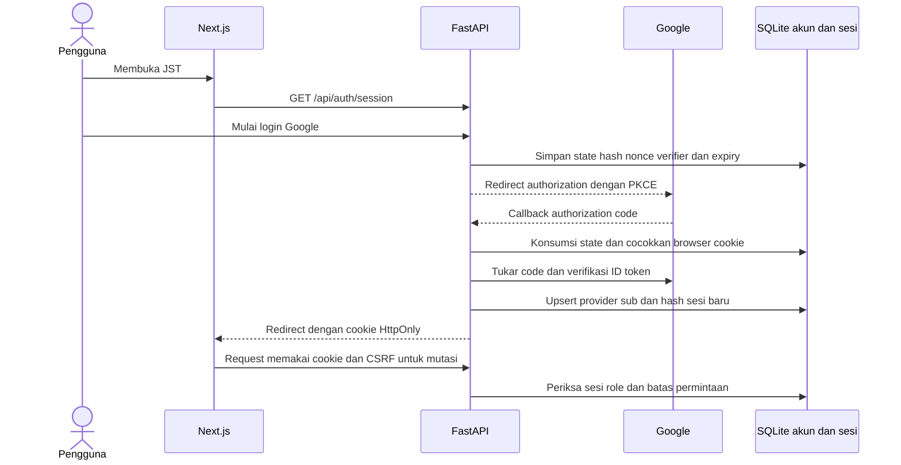

# Bukti implementasi dan pemeriksaan Google Auth JST

Tanggal: **29 Oktober 2026** · Branch: **feat/google-auth** · Basis: **fecc27b**.

## Kesimpulan pemeriksaan

Fitur login Google wajib dan dashboard khusus developer sudah diimplementasikan. Login nyata berhasil dikonfirmasi pengguna pada sesi pengembangan. Setelah hardening, 53 tes backend, pemeriksaan TypeScript, dan build produksi frontend terisolasi berhasil. Audit npm untuk dependensi production melaporkan nol advisory.

**Ini bukan pernyataan bahwa seluruh aplikasi bebas celah atau siap dipublikasikan.** Audit Python masih menemukan advisory pada ChromaDB. PyMuPDF telah diganti dengan pypdf dan tidak lagi terpasang pada environment aktif. Jalur yang dilaporkan tidak dipakai sebagai endpoint publik pada implementasi ini, tetapi temuan paket belum tertutup. Persetujuan deployment internet tanpa syarat belum diberikan. Scope yang dinilai adalah kode dan lingkungan pengembangan lokal.

## Permintaan dan perilaku yang diwujudkan

| Permintaan | Implementasi | Bukti |
| --- | --- | --- |
| Harus login untuk memakai chatbot | UI menunggu pemeriksaan sesi; API chat memerlukan sesi valid | Tes anonymous 401 dan konfigurasi tidak lengkap 503 |
| Dashboard hanya developer | Role ditentukan server, bukan input browser; halaman dan API manajemen dibatasi | Tes user 403, developer 200, role palsu ditolak |
| Login Google | Authorization code, state sekali pakai, browser binding, nonce dan PKCE S256 | Tes callback/replay/nonce dan pengujian token bertanda tangan |
| Sesi dapat dicabut | Token acak HttpOnly; hash disimpan server; logout menghapus sesi | Tes hash, rotasi, idle/absolute expiry, logout |
| History akun tidak tercampur | Namespace localStorage berdasarkan user ID; legacy tidak diimpor otomatis | Tinjauan kode provider dan penyimpanan chat; belum history server |
| Aman menyiapkan konfigurasi | `.env.example` hanya contoh; `.env` lama tidak disalin ulang | Panduan setup dan pemeriksaan kandidat commit |

## Arsitektur

Identitas permanen menggunakan pasangan `google` dan `sub`. Email adalah atribut yang dapat berubah. Akun/sesi berada di `backend/data/auth.sqlite`, terpisah dari pengetahuan RAG. Migrasi schema v2 menambahkan indikator otoritas email Google dan tabel pembatasan request tanpa menghapus akun/sesi lama. Perubahan email atau otoritas identitas saat login mencabut seluruh sesi lama pengguna tersebut.

## Kontrol keamanan

- Google ID token diverifikasi oleh library resmi: signature, issuer, audience, expiry. Nonce dan email terverifikasi diperiksa aplikasi. Toleransi jam terbatas 30 detik; verifikasi tidak dimatikan.
- State acak dan cookie browser harus cocok, hanya dapat dikonsumsi sekali, masa berlaku sepuluh menit. PKCE memakai S256.
- Cookie sesi HttpOnly dan SameSite=Lax. HTTPS memakai Secure dan prefix `__Host-` dengan Path `/` tanpa Domain. HTTP hanya diterima untuk pengembangan loopback.
- Sesi maksimal delapan jam, idle timeout 30 menit. Token sesi mentah tidak disimpan dalam database; token Google tidak dipersistenkan.
- Mutasi API memerlukan Origin frontend yang tepat dan token CSRF. CORS kredensial hanya menerima `AUTH_PUBLIC_URL`; wildcard/daftar legacy tidak memperluas origin.
- Seluruh API ditutup secara default; hanya session/login/callback yang publik. Dokumentasi API juga memerlukan developer. Model bagi akun biasa dipilih server.
- Role developer memerlukan email pada daftar server **dan** bukti Google authoritative: akun Gmail atau email terverifikasi dengan claim Workspace `hd`. Email pihak ketiga tanpa claim tersebut tidak otomatis memperoleh hak developer. Ini mengikuti batas otoritas email yang dijelaskan Google.
- Allowlist yang aktif juga memerlukan bukti otoritas email. Sesi lama dievaluasi ulang terhadap allowlist dan role server pada request berikutnya setelah konfigurasi dimuat ulang.
- Pembatasan lokal: login 20/menit per alamat koneksi, pemeriksaan sesi 120/menit per alamat koneksi, chat 10/menit per akun, API umum 120/menit per akun. Header X-Forwarded-For tidak dipakai langsung untuk menentukan key. Deployment proxy masih harus mengonfigurasi trusted proxy dengan benar.
- Maksimal 100 flow login aktif. Logout tetap dapat dilakukan ketika batas API umum habis, dengan sesi dan CSRF yang sah.
- Body JSON dibatasi 1 MiB, envelope unggahan 21 MiB dan file unggahan 20 MiB. Pembatasan juga bekerja tanpa Content-Length. Batas ini belum menggantikan pembatasan koneksi/dekompresi di gateway.
- Respons auth/API dan penolakan tidak boleh di-cache. Query callback dibersihkan sebelum access log aplikasi; proxy di depan aplikasi perlu aturan serupa.
- UI merender teks melalui React, tanpa `dangerouslySetInnerHTML` atau eksekusi teks model yang ditemukan dalam pemeriksaan source.

## Temuan yang diperbaiki

| ID | Temuan atau kekurangan | Tindakan |
| --- | --- | --- |
| AUTH01 | Eskalasi hak developer hanya berdasarkan email terverifikasi pihak ketiga | Simpan bukti Gmail/Workspace, fail closed untuk hak istimewa dan allowlist |
| AUTH02 | Sesi lain dapat tetap aktif setelah perubahan identitas email | Cabut seluruh sesi lama saat email/otoritas berubah |
| AUTH03 | Percobaan login dan request akun belum dibatasi | Counter server per IP koneksi/per akun dan respons 429 |
| AUTH04 | Parser dapat membaca body besar sebelum pemeriksaan ukuran file | Middleware ASGI bounded body serta bounded file read |
| AUTH05 | CORS dapat melebar melalui konfigurasi legacy | Hanya origin frontend auth yang dipercaya |
| AUTH06 | Cookie HTTPS belum memakai host prefix; penolakan belum konsisten no-store | Host prefix dan no-store pada seluruh respons auth/error |
| AUTH07 | Batas API berpotensi menghalangi logout | Logout dikecualikan dari counter umum, tetap memeriksa CSRF |
| DEP01 | Advisory transitif PostCSS dalam dependency Next.js | Override PostCSS 8.5.32, lock diperbarui, build dan npm audit ulang lolos |

Tabel ini mencakup hardening preventif serta kekurangan kode yang ditemukan; bukan bukti bahwa semuanya pernah dieksploitasi pada layanan pengguna.

## Temuan dependensi yang belum tertutup

### ChromaDB 1.5.9

Audit mencatat empat advisory unik: CVE-2026-45829, CVE-2026-45833, CVE-2026-45831, dan CVE-2026-45830. Beberapa entri scanner merupakan duplikasi ID yang sama. Pada saat pemeriksaan, sumber advisory tidak memberikan versi patch untuk temuan tersebut.

Jalur yang dijelaskan melibatkan HTTP API Chroma, pengaturan embedding remote, atau otorisasi tenant/collection. JST memakai `PersistentClient` embedded, nama koleksi dari server, embedding vektor eksplisit, serta `embedding_function=None`. Aplikasi tidak memasang HTTP server Chroma atau meneruskan pilihan model repo/trust_remote_code dari pengguna. Route mentah Chroma tidak termasuk route aplikasi yang ditinjau.

**Batas mitigasi:** ini membatasi keterjangkauan jalur di aplikasi sekarang, bukan menambal library. Jangan membuka Chroma HTTP server, menambah remote embedding yang dikendalikan pengguna, atau menganggap temuan hilang. Tinjau patch/vendor atau alternatif penyimpanan sebelum perubahan arsitektur/deployment publik.

### Penyelesaian pemblokiran PyMuPDF pada Windows

Log CodeIntegrity Event 3077 memastikan `_mupdf.pyd` tidak memenuhi kebijakan penandatanganan perangkat. Rilis patch PyMuPDF yang diuji juga ditolak. Smart App Control tidak menyediakan pengecualian per aplikasi; pengaturan proteksi tidak diubah.

PyMuPDF dan PyMuPDF4LLM dihapus dari dependensi semua platform dan diganti satu paket pure Python, **pypdf 6.21.4**. Parser membaca stream dalam memori tanpa file sementara atau DLL PDF native. Sisa metadata instalasi lama dibersihkan setelah backend dihentikan sementara. Backend kemudian berhasil dinyalakan kembali; status Smart App Control terukur `1` (On), endpoint sesi HTTP 200, dan `uv pip check` lolos.

Enam pengujian ingestion mencakup teks PDF masuk koleksi, PDF rusak/terenkripsi/kosong/tanpa teks ditolak sebelum penulisan, serta regresi Excel. Seluruh suite menjadi 53 tes. Pemindaian paket aktif tidak lagi melaporkan PyMuPDF atau pypdf; hanya advisory ChromaDB tersisa. Ini hasil pemindaian saat pemeriksaan, bukan jaminan bebas celah.

**Batasan:** ekstraksi memakai `extract_text(extraction_mode="layout")`, bukan konversi Markdown PyMuPDF4LLM. Tabel kompleks, multi-kolom, dan urutan baca memerlukan UAT dokumen representatif. PDF scan tanpa lapisan teks belum didukung OCR. Batas resource dan screening dokumen tetap pekerjaan lanjutan.

## Bukti pengujian

| Pemeriksaan | Hasil | Artefak |
| --- | --- | --- |
| Unittest backend | 53 passed, 0 failed | `evidence/google-auth/backend-tests.txt` |
| TypeScript noEmit dan noUnusedLocals | Lolos | Ringkasan verifikasi JSON |
| Build produksi frontend terisolasi | Lolos, route / /admin /audit tercetak | `evidence/google-auth/frontend-build.txt` |
| npm audit production setelah patch | 0 advisory | Ringkasan verifikasi JSON |
| pip-audit paket backend | Temuan masih ada pada ChromaDB; PyMuPDF sudah dihapus | Ringkasan verifikasi JSON, tidak disembunyikan |
| Login Google nyata | Berhasil dikonfirmasi pengguna pada 29 Oktober sebelum hardening akhir | Catatan percakapan; bukan screenshot akun atau token |
| Migrasi akun lama, cookie HTTPS, eskalasi role, revoke akses | Lolos dengan database/identitas uji | `tests/test_auth_hardening.py` dan log backend |

Build pertama di folder lintas drive gagal karena resolusi junction Windows; pengulangan di folder terisolasi pada drive proyek berhasil. Cache server frontend aktif tidak dipakai untuk build. Konfigurasi `.env` tidak disalin ke folder build.

## Batas pemeriksaan dan pekerjaan lanjutan

- Bukan penetration test independen, audit formal, atau sertifikasi keamanan. Beban tinggi, distributed rate limiting, failover, dan serangan infrastruktur tidak diuji.
- Perlu UAT nyata dengan dua akun/perangkat, logout lintas tab, dan role developer setelah hardening terakhir; kasus server otomatis sudah diuji.
- Riwayat masih localStorage per akun, bukan database history server. Orang yang menguasai profil browser/perangkat dapat mengakses storage lokal; tidak ada klaim enkripsi/isolasi perangkat. Riwayat lokal dibersihkan ketika logout normal.
- Penghapusan akun, pencabutan semua perangkat melalui UI, audit akses lengkap, dan pemulihan draf setelah sesi habis belum tersedia.
- Screening sumber, verifikasi fakta/entailment kutipan, dataset training dan fine-tuning bukan bagian login ini. Akun biasa hanya memakai korpus aktif bersama yang boleh dibagikan.
- HTTPS, trusted proxy, CSP yang sesuai Next.js, pengaturan log proxy, secret management, ACL/backup database, dan penyelesaian advisory harus diverifikasi sebelum publikasi Cloudflare.
- Counter SQLite lokal bukan perlindungan DDoS dan alamat koneksi dapat menjadi alamat gateway. Jangan mengaktifkan kepercayaan header proxy dari semua alamat.
- Tidak ada izin deployment atau push otomatis yang diberikan oleh laporan ini.

## Berkas implementasi

Backend: `app/auth.py`, `app/main.py`, `app/rag_ingestion.py`, `pyproject.toml`, `uv.lock`, `.env.example`, `tests/test_auth.py`, dan `tests/test_auth_hardening.py`.

Frontend: `src/components/AuthProvider.tsx`, `src/lib/api.ts`, `src/app/auth.css`, `src/app/layout.tsx`, `src/app/page.tsx`, panel dashboard/chunk, `package.json`, dan `package-lock.json`.

Panduan operasional: [GOOGLE_AUTH_SETUP.md](GOOGLE_AUTH_SETUP.md). Bukti mesin dan hash source: [verification-summary.json](evidence/google-auth/verification-summary.json). Berkas `.env`, database akun, environment Python, direktori build sementara, dan kredensial tidak dimasukkan ke Git.

## Referensi

- Google ID token dan batas otoritas email: https://developers.google.com/identity/gsi/web/reference/html-reference
- Google OIDC: https://developers.google.com/identity/openid-connect/openid-connect
- OWASP Session Management: https://cheatsheetseries.owasp.org/cheatsheets/Session_Management_Cheat_Sheet.html
- PostCSS: https://github.com/advisories/GHSA-fxqj-rqcc-2cmp
- PyMuPDF: https://github.com/advisories/GHSA-cxqh-p2w9-fmr7
- ChromaDB pre-auth injection: https://github.com/advisories/GHSA-f4j7-r4q5-qw2c

Advisory diperiksa pada 29 Oktober 2026. Status dapat berubah; jalankan ulang scanner dan evaluasi keterjangkauan jalur ketika dependensi/arsitektur berubah.
